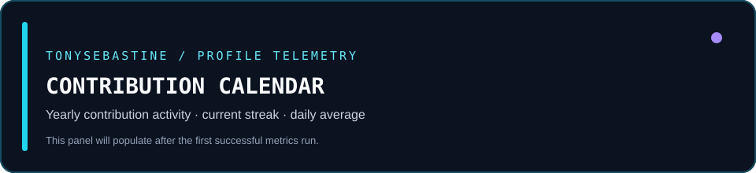
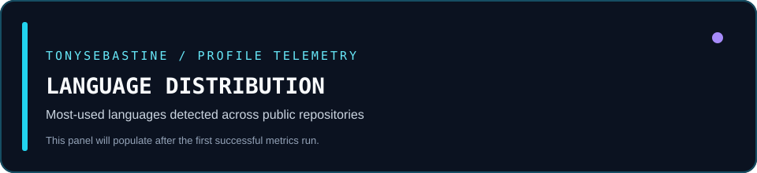

# TONY SEBASTIAN

### FULL-STACK DEVELOPER · CYBERSECURITY · AI AUTOMATION

Building secure applications, practical security tools, and reliable infrastructure.

[Portfolio](https://thbz.in) · [GitHub](https://github.com/tonysebastine) · [LinkedIn](https://www.linkedin.com/in/tonysebastine) · [TryHackMe](https://tryhackme.com/p/tonysebastine) · [Email](mailto:tony@thbz.in)

<code>BUILD WITH PURPOSE</code> &nbsp; <code>SECURE BY DESIGN</code> &nbsp; <code>AUTOMATE THE REPEATABLE</code>

---

<table>
<tr>
<td width="58%" valign="top">

## PROFILE / 01

I'm **Tony Sebastian**, a self-taught developer from Kerala, India, with a background in technical support, networking, and system administration.

I work across full-stack development, application security, Linux infrastructure, and AI-powered automation. I enjoy taking projects from an initial idea through implementation, deployment, and hardening.

My approach is practical: understand the system, make it useful, keep it maintainable, and design security into the process.

</td>
<td width="42%" valign="top">

## OPERATIONAL FOCUS

- **Application engineering** — web apps, APIs, integrations
- **Security engineering** — assessment, secure design, remediation
- **Infrastructure** — Linux, networking, virtualization, hosting
- **AI & automation** — local LLMs, agents, repeatable workflows
- **Open source** — useful tools and engineering experiments

</td>
</tr>
</table>

## FEATURED BUILDS / 02

<table>
<tr>
<td width="50%" valign="top">

### 🛡️ OpenSentinel

**AI-assisted security assessment platform**

An open-source security tooling project combining automated scanning with LLM-assisted finding analysis.

- Nmap and OWASP ZAP integration
- AI-assisted vulnerability interpretation
- Findings and remediation reporting
- Web interface and CLI companion

[Explore repository ↗](https://github.com/tonysebastine/OpenSentinel)

</td>
<td width="50%" valign="top">

### ⚙️ ALFA Panel

**Security-first hosting control panel**

A hosting control-plane project focused on secure deployment and isolated workloads for Python and Tomcat applications.

- Linux host management and site lifecycle
- Deployment and backup automation
- Firewall and access-control integration
- Container isolation and reverse-proxy integration

[Explore repository ↗](https://github.com/tonysebastine/alfa-panel)

</td>
</tr>
<tr>
<td width="50%" valign="top">

### 📊 SpotGuard

**Binance Spot strategy research**

A private research project exploring systematic spot strategies with an emphasis on validation before deployment.

- Historical market-data analysis
- Strategy backtesting and comparison
- Risk and performance evaluation
- Paper-trading / testnet-first approach

Private repository · Research and simulation

</td>
<td width="50%" valign="top">

### 🧠 Local AI Lab

**AI workflows and developer automation**

Hands-on experimentation with local language models and automation patterns for practical engineering tasks.

- Local LLM inference
- AI-assisted development workflows
- Security automation concepts
- Agent and tool integrations

Ongoing experiments

</td>
</tr>
</table>

## ENGINEERING STACK / 03

<table>
<tr>
<td width="50%" valign="top">

**APPLICATION DEVELOPMENT**

`Next.js` `React` `Node.js` `Express` `JavaScript` `Python` `Go` `PHP` `Laravel` `HTML` `CSS` `Tailwind CSS`

**DATABASES & SERVICES**

`MongoDB` `MySQL` `PostgreSQL` `Supabase` `WHMCS`

</td>
<td width="50%" valign="top">

**INFRASTRUCTURE & DELIVERY**

`Linux` `Docker` `Proxmox VE` `Nginx` `Cloudflare` `Tailscale` `Git` `GitHub`

**SECURITY & AI TOOLING**

`Kali Linux` `Nmap` `OWASP ZAP` `Ollama` `Cursor` `VS Code`

</td>
</tr>
</table>

---

## LIVE GITHUB TELEMETRY / 04

Automatically generated from public GitHub activity. Images are committed to this repository by the scheduled workflow, rather than loaded from third-party stats hosts.

<strong>▸ Account overview, repositories, community and achievements</strong>

 

<strong>▸ Community metrics · issues, pull requests and achievements</strong>

 

<strong>▸ Commit calendar · yearly activity</strong>

 

<strong>▸ Language distribution</strong>

 

<strong>▸ Coding habits · recent GitHub activity patterns</strong>

 

Activity patterns are inferred from GitHub events. They are not a measurement of time spent in an editor or IDE.

Metrics refresh daily at approximately 05:47 India Standard Time (UTC+05:30), after the workflow is configured. You can also trigger an update manually from the Actions tab.

---

## CURRENT FOCUS / 05

| Track | Current direction |
|:--|:--|
| **Application security** | Secure-by-design development, vulnerability assessment, remediation |
| **Hosting infrastructure** | Linux, virtualization, isolation, backup and deployment automation |
| **AI engineering** | Local LLMs, agent workflows and practical automation |
| **Full-stack development** | Maintainable web applications, APIs and integrations |
| **Open source** | Building and refining tools that solve real engineering problems |

## CONNECT / 06

Interested in useful engineering challenges, security-focused development, infrastructure projects, and open-source collaboration.

[thbz.in](https://thbz.in) · [GitHub](https://github.com/tonysebastine) · [LinkedIn](https://www.linkedin.com/in/tonysebastine) · [TryHackMe](https://tryhackme.com/p/tonysebastine) · [tony@thbz.in](mailto:tony@thbz.in)

**Design thoughtfully. Engineer securely. Keep learning.**

