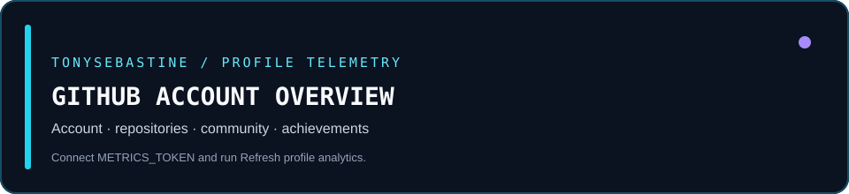
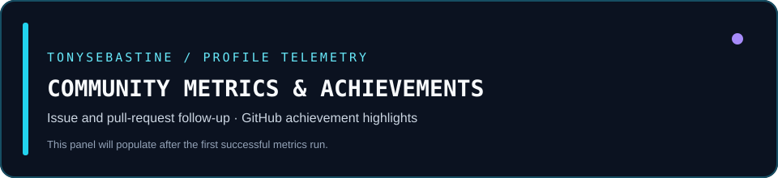
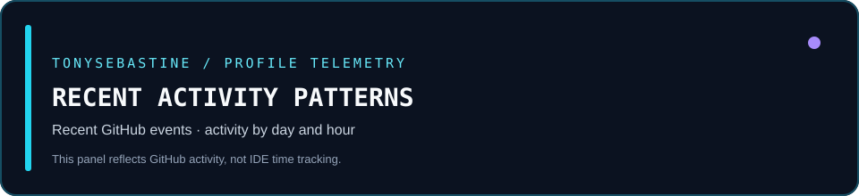

# Tony Sebastian

**Full-Stack Developer · Cybersecurity · AI Automation**

Building secure applications, useful tools and reliable infrastructure.

[Website](https://thbz.in) · [GitHub](https://github.com/tonysebastine) · [LinkedIn](https://www.linkedin.com/in/tonysebastine) · [TryHackMe](https://tryhackme.com/p/tonysebastine) · [Email](mailto:tony@thbz.in)

---

## About

I'm a self-taught developer from Kerala, India, with a background in technical support, networking and system administration.

I work across full-stack development, application security, Linux infrastructure and AI-powered automation. I enjoy turning ideas into practical software, improving how systems are deployed, and making security part of the engineering process.

## Featured projects

### [OpenSentinel](https://github.com/tonysebastine/OpenSentinel) · AI-assisted security assessment

An open-source security tooling project that combines automated scanning with AI-assisted analysis.

- Nmap and OWASP ZAP integration
- LLM-assisted finding analysis and remediation guidance
- Web interface and CLI companion

### [ALFA Panel](https://github.com/tonysebastine/alfa-panel) · Hosting control panel

A security-first hosting management platform for Python and Tomcat workloads.

- Linux host and site management
- Deployment and backup automation
- Firewall integration and workload isolation

### SpotGuard · Binance Spot strategy research

A private research project focused on strategy testing and risk evaluation before deployment.

- Historical market data and backtesting
- Strategy comparison and performance analysis
- Paper-trading and testnet-first approach

## Technology

**Development**  
`Next.js` · `React` · `Node.js` · `Express` · `JavaScript` · `Python` · `Go` · `PHP` · `Laravel` · `Tailwind CSS`

**Databases & services**  
`MongoDB` · `MySQL` · `PostgreSQL` · `Supabase` · `WHMCS`

**Infrastructure**  
`Linux` · `Docker` · `Proxmox` · `Nginx` · `Cloudflare` · `Tailscale` · `Git`

**Security & AI**  
`Kali Linux` · `Nmap` · `OWASP ZAP` · `Ollama` · `Cursor` · `VS Code`

## GitHub activity

Automatically generated from public GitHub activity and stored in this repository. The metrics images are refreshed by GitHub Actions.

<strong>Contribution calendar</strong>

 

<strong>Languages and community</strong>

 

 

<strong>Recent activity patterns</strong>

 

This reflects GitHub events, not editor or IDE time tracking.

## Get in touch

Open to interesting engineering challenges, freelance work, security-focused projects and open-source collaboration.

**[thbz.in](https://thbz.in)** · **[LinkedIn](https://www.linkedin.com/in/tonysebastine)** · **[TryHackMe](https://tryhackme.com/p/tonysebastine)** · **[tony@thbz.in](mailto:tony@thbz.in)**

*Build thoughtfully. Engineer securely. Keep learning.*

